 #智能麦轮机械臂小车 开发日志

> 项目：麦轮机械臂小车　作者：崔乐琦　　
> 硬件平台：STM32F103C8T6 + 双 DRV8833 驱动 + 4× 麦克纳姆轮 + 4× SG90 舵机 + PS2 无线手柄+mini降压模块+两个18650 3.7V锂电池+2×mg96r舵机 
> 开发环境：Keil 5（STM32 标准外设库）

##一、麦轮底盘运动控制模块

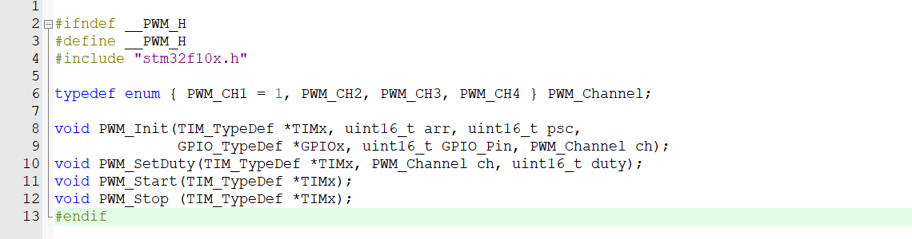
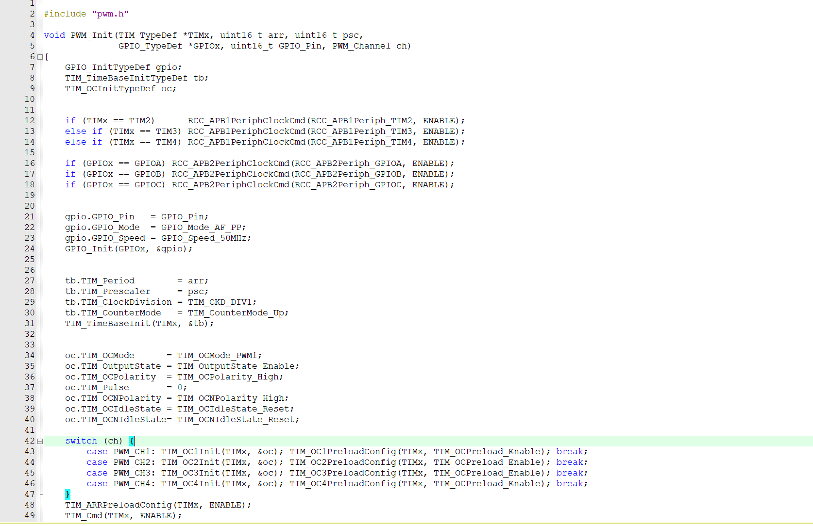
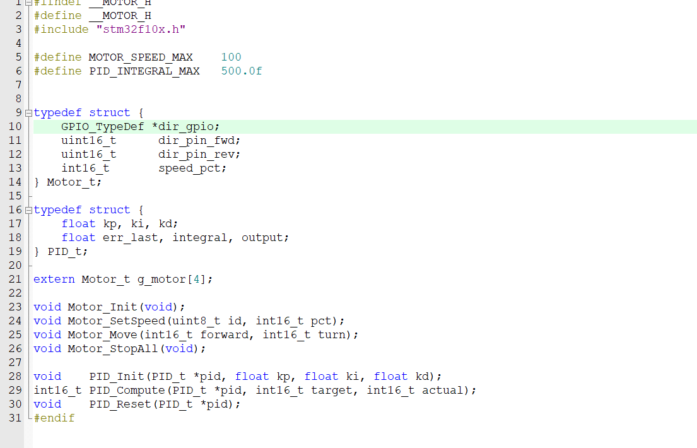
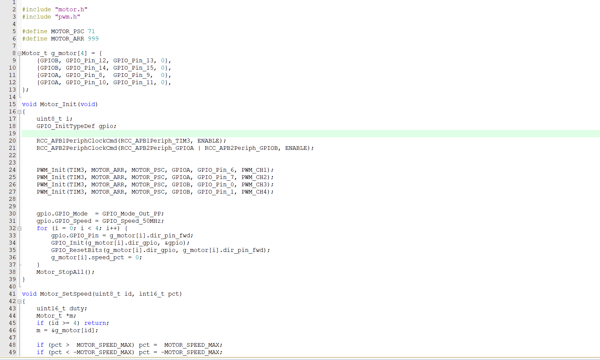

###功能描述
实现麦克纳姆轮简单地按照循环转动并做出适配的电机驱动，完成无线遥控模块后，麦克纳姆轮可以进行全向运动：左摇杆控制前后左右，右摇杆控制转向，四轮按运动学模型混控输出。驱动采用 DRV8833 双路 H 桥，每路电机由 IN1、IN2 两个输入控制，支持正转、反转与停止。模块对外提供 `Motor_SetSpeed(id, pct)` 与 `Motor_StopAll` 接口，`id` 为逻辑轮号（0 左前、1 右前、2 左后、3 右后），`pct` 为带符号速度百分比。

###开发历程
我们驱动采用单 PWM 方案：每路电机的 IN1 接定时器 PWM 作调速，IN2 接普通 GPIO 作方向电平，正转与反转通过 IN2 电平切换、IN1 占空比调速实现。

单 PWM 方案在调试中暴露出反转侧的物理缺陷：当 IN2 置为反转电平时，IN1 的高电平对应 H 桥的刹车状态、低电平才对应驱动状态。因此若反转占空比与正转一样直接取 |pct| 的线性映射，则速度指令越大、刹车时间越长，表现为"后退推到底卡死、轻推才转"，且原地转向时反转一侧的轮子在低速段常常不转。

针对该问题，在驱动层对反转占空比做了取反补偿——将反转时写入 IN1 的脉宽改为 `ARR − |pct|·ARR/MAX`（即 `motor.c` 反转分支 `duty = (uint16_t)(MOTOR_ARR - (uint32_t)(-pct) * MOTOR_ARR / MOTOR_SPEED_MAX);`），使反转的有效驱动脉宽与正转在相同速度指令下对称，从而在单 PWM 硬件下让后退与转向获得可用的力矩与一致性。配合控制层的摇杆死区、左右轮配平系数与上电采零点，底盘达到稳定可用。

## 二、无线遥控通信模块

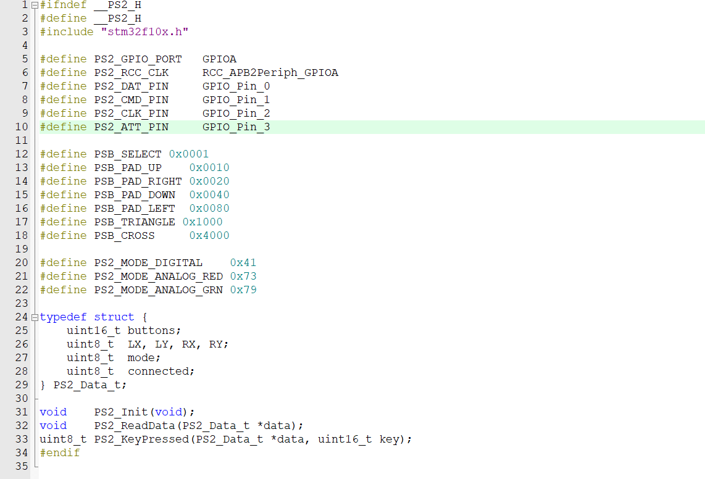

###功能描述
通过 PS2 接收器以 SPI 协议读取手柄的左右摇杆模拟量与全部按键状态，为底盘运动与机械臂控制提供统一的人机输入接口。模块对外提供 `PS2_Init`、`PS2_ReadData`、`PSB_KeyPressed` 三个接口，输出结构体包含 `LX/LY/RX/RY` 四路摇杆值、`buttons` 按键位掩码与 `connected` 连接标志。

 ###开发历程
通信引脚最初占用 PA0～PA3，后期因电机驱动重新分配引脚，将 PS2 整体迁移至 PB12～PB15（CLK=PB13、CS=PB12、CMD=PB15、DAT=PB14），迁移后仅需修改头文件中的引脚宏，驱动逻辑无需改动，验证了"引脚定义集中在头文件宏"这一分层设计的价值。

开发中遇到的核心问题是摇杆轴串位，实测发现手柄的左 Y 与右 X 数据在接收端发生互换，导致"推前后"被识别为"推转向"。该现象最初被误判为接线错误，经逐帧核对通信时序后确认是手柄固件的帧序特性，最终在控制层通过取值映射修正，并在驱动层校准了按键位掩码（补全 △○□× 与肩键定义），使按键读取稳定可靠。

##三、舵机驱动封装模块

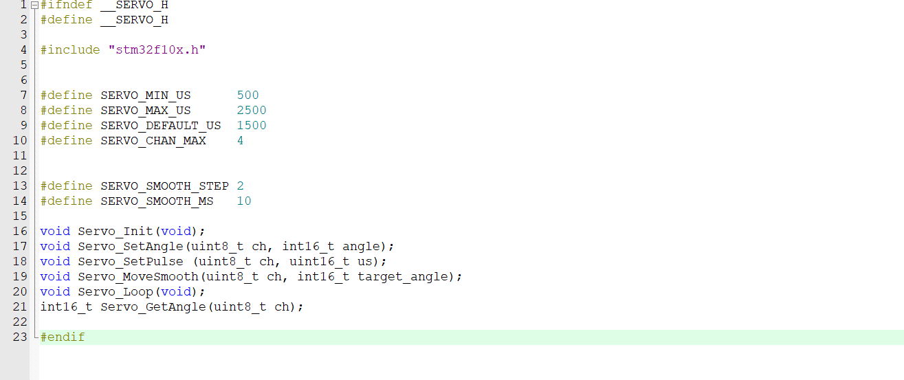
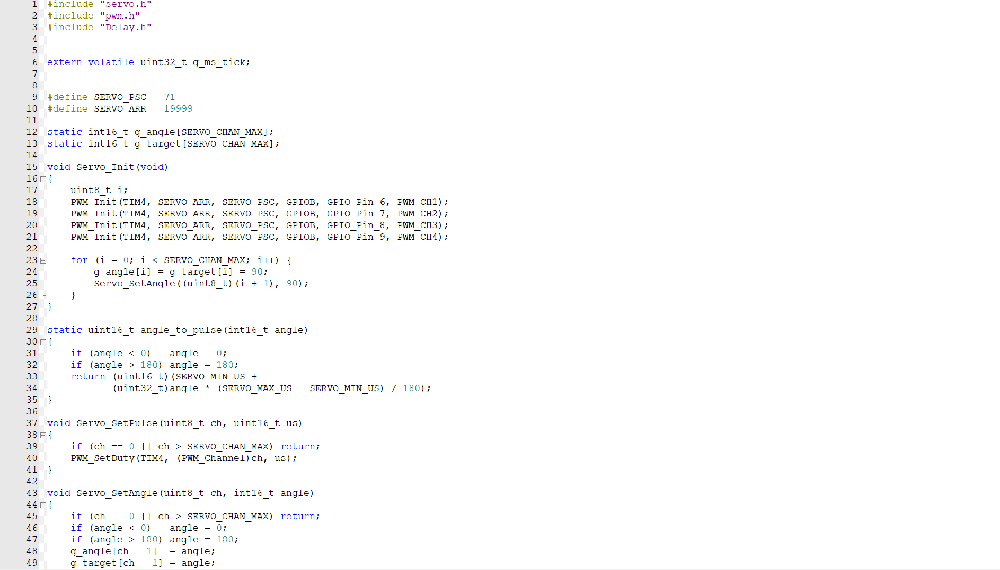

###功能描述
为 SG90 舵机提供统一的脉宽—角度封装，支持 0～180° 角度控制与脉宽直接控制两种接口，并可平滑插值。模块基于定时器 PWM 实现 50Hz 信号，将角度线性映射为 500～2500μs 脉宽，对外提供 `Servo_Init`、`Servo_SetAngle`、`Servo_SetPulse`、`Servo_MoveSmooth`、`Servo_Loop` 接口，通道号为 1 起始。

###开发历程
本模块在独立夹爪阶段引入，在1号车上用两个引脚（PA6，PA7），在2号车上用了4个引脚（PA6，PA7，PA8，PA9），正好占满 TIM4 的四个通道，与电机、PS2 零冲突。

封装设计上有两处反复确认的要点：其一，通道号为 1 起始，传 0 会被接口静默忽略，这是调试初期"某路舵机无反应"的根因之一；其二，平滑插值接口依赖全局毫秒计数器，而项目延时模块采用轮询方式、未开启系统滴答中断，二者争用同一时基会导致平滑逻辑卡死。因此控制层统一采用"立即到位"的角度接口，依靠舵机自身限速实现视觉平滑，既稳定又规避了时基冲突。该取舍在日志中如实记录，作为"接口选择需匹配底层时基"的经验。

 ##四、机械臂与夹爪控制模块

 ###功能描述
将手柄按键映射到四路舵机，实现机械臂多关节与夹爪的离散控制：方向键上下控制主臂、方向键左右控制第二关节、△/× 控制从臂、○/□ 控制夹爪。所有关节采用"按住转动、松开停止、对应键反转"的增量控制方式，每路独立累加并限幅于安全角度区间。后期新增 R1 按键，用于在慢速档与快速档之间切换四路舵机的步进速度，兼顾精细对位与快速摆位。

###开发历程
最初设想为两轴即x，z轴，y轴靠车体移动控制，将高台方块扫下来供收集车收集，后期测试发现车体控制误差太大不好操控，遂改为3轴机械臂，即关节舵机机械臂，但末端得随时调整保持水平，后搜寻其他种类发现mearm机械臂（即平行四边形连杆机械臂），末端始终保持与地面平行，前期使用4个sg90舵机移动，但大臂小臂处扭力不够，遂改为mg96r舵机。
操作上，在通电后设置初始姿态，即收缩姿态，一是便于测量尺寸以便检录，而是重心稳定不易倾倒；在"全车集成"阶段与底盘融合，控制逻辑从早期"按一下自动往返复位"调整为"按住连续转、松开即停"，以匹配机械臂需要停在任意角度的实际情况。

开发中处理了三类典型问题。一是**连续旋转与角度旋转的区分**：机械臂底盘一度使用 360° 连续旋转舵机，需以脉宽速度方式控制，但发现360度舵机无限位，会使线路缠死，后按要求统一改回 180° 角度舵机，四路全部采用增量限幅控制，逻辑归一。二是**角度限位与堵转防护**：SG90 转至行程死点会持续堵转发热、损伤齿轮，故每路下限/上限预留余量（默认 5°～175°），并要求按机械实测收紧，避免长期顶死。三是**转速档切换**：以 R1 边沿检测在慢/快两档间切换，切换瞬间以板载 LED 闪烁作反馈，断连时吞掉按键边沿防止重连误切。

此外，针对"某些角度转不动、某些角度正常"的现象，进行了负载扭矩分析：SG90 输出扭矩基本恒定，而悬臂负载力矩随角度变化，水平位附近力臂最大、最易超过舵机扭矩，表现为"挑角度卡死"。该问题属物理极限，代码无法增加扭矩，最终结论为通过配重平衡、缩短力臂或更换大扭矩舵机解决，并补充了"按住超时自动停"的防烧逻辑作为软件侧缓解。

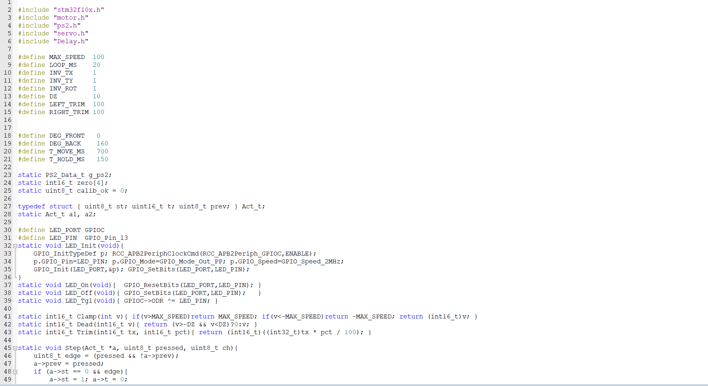
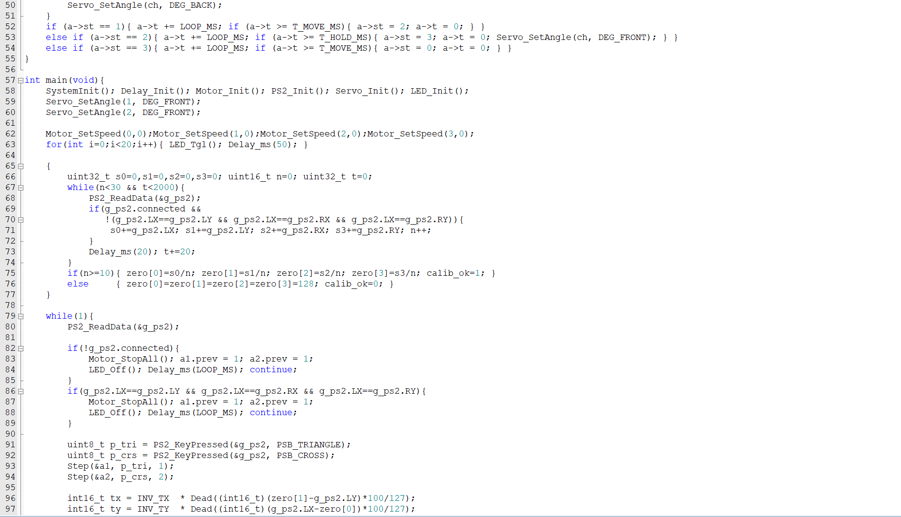
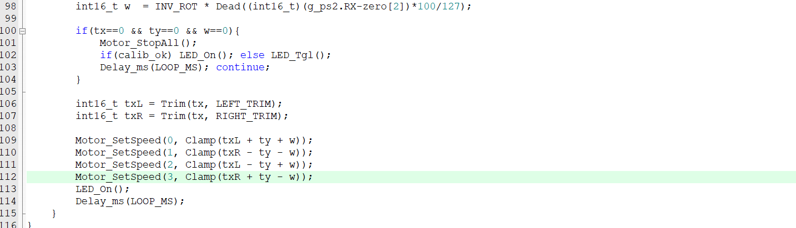

 ##五、两车系统集成模块

###功能描述
1 号车与 2 号车共用同一套融合主程序框架：将底盘与机械臂控制融合为单一主程序，统一读取手柄数据，并行推进电机与四路舵机，互不阻塞。
1 号车采用底盘反转的低姿态，配合铲斗 / 双臂完成方块的挤入、闭合与容纳。
2 号车承担高台、洞内、细杆方块的推送与转移，自身以改变方块位置为主。
两车集成上电自检流程一致：先令四轮停止并快闪 LED 验证停止逻辑，再采集松手状态下的摇杆零点以消除中位偏移，随后进入控制循环。提供连接状态诊断：LED 常亮表示手柄已连、慢闪表示零点校准失败、熄灭表示断连或错帧；断连与错帧时电机急停、舵机保持原位不跳变，防止失控。

###开发历程
集成阶段的主要工作是引脚资源统筹与控制时序统一。两车最终引脚分配经逐脚核对确认无重叠：电机 IN1 由一个定时器的四路 PWM 提供、IN2 为四个普通 GPIO 方向脚（具体方向脚以实物接线为准）；舵机由另一定时器提供四路 PWM（A 车 2 脚、B 车 4 脚，对应 TIM4 通道）；PS2 占用 PB12～PB15；调试串口 USART3（PB10/11）、下载口 SWD（PA13/14）、诊断 LED（PC13）。该分配表在集成时定稿，并成为后续所有换脚操作的基准。
控制时序上，将舵机按键处理置于电机判断之前，确保 "松手停车" 时舵机仍能响应按键；同时统一了按键边沿检测与摇杆死区处理，避免误触发。集成过程中曾出现 "左前、左后轮完全不转而右侧正常" 的故障，因两路在代码中不共用任何引脚，故判定为硬件通路问题，最终定位为驱动板焊接虚焊，以及电机方向脚接线与驱动代码版本不一致所致，经补焊与统一接线版本后排除。该排障过程作为 "软件无解时转向硬件通路排查" 的方法论记录。

##六、硬件调试与可靠性分析

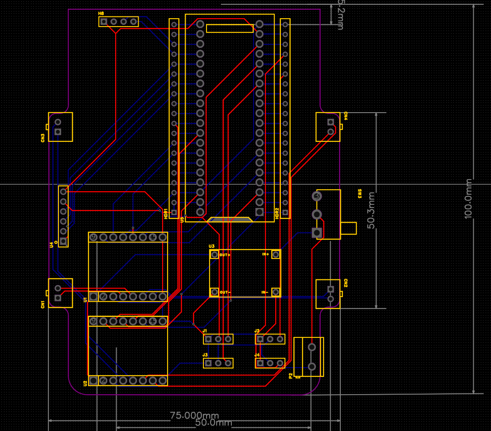
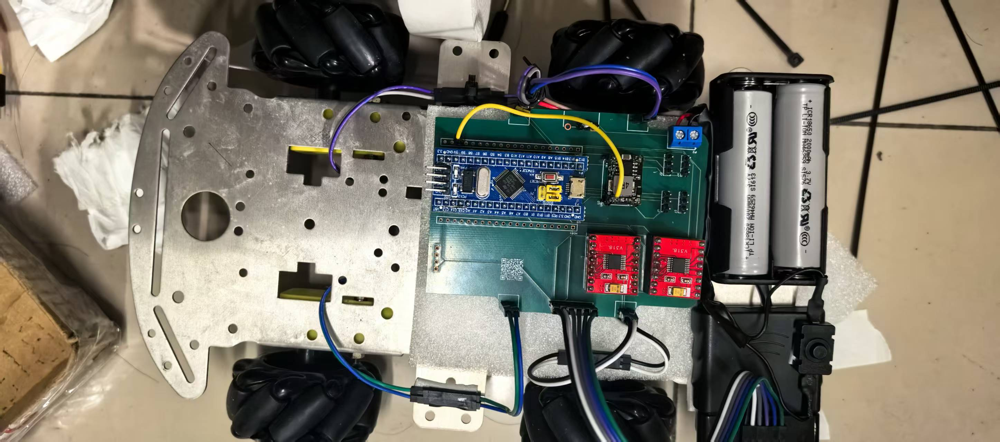
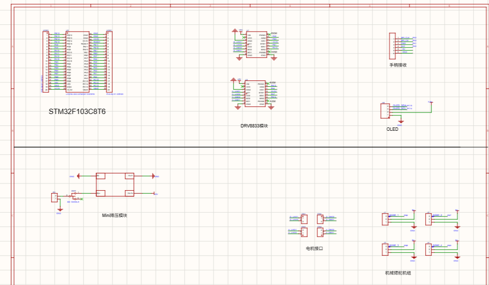

### 功能描述
使用自制PCB板材，极大提升硬件电路稳定性，主要构成有：
电源电池盒增加按压开关，不用再抠电池，电源接口采用KF301-2P端子接入pcb板子，一是螺钉式接线使接线牢固，二是避免电源线裸露导致短接（前期烧过一个电池盒）；
后接优信电子降压模块（5V），in+、in-接入，out+、out-引出至stm325V引脚、ps2接收器VCC引脚v8833VM引脚；
对于stm32f103c8t6模块，根据手册，PA6、7、8、9有计时器，因此作为舵机信号引脚；PB0、1、PA8、PA连接drv8833的AIN1、AIN2、BIN1、BIN2
对电源增加开关设计，保证电路安全；我们采用的电池标准电压为7.4V，因此采用优信电子降压模块降压为5V，以此为stm32和驱动模块供电。

### 开发历程
在硬件开发中，我们最开始使用面包板测试，发现其稳定性差，接线不牢固，容易断连，稳定性极差，随后我们自主设计一套适配的PCB板材，解决此问题

随后我们发现在烧录时电池开关不好控制，遂为电池盒增加开关，以便更好的开关电路

在PCB焊接时我们遇到各种问题，焊接不牢固，掉锡，板材破损等问题，我们特此为PCB增加子针脚，可以更好的拆卸PCB上的stm32和驱动模块等

在焊接测试时我们遇到问题使用多功能万用表排查漏洞，排查过焊接不牢等问题。

## 七、整机成本预算与采购单

### 1.预算总览
- 整机建议预算上限：400.00元
- 实际已采购总花费：411.86 元

### 2.零部件采购清单
|序号|器件名称|数量|单价(元)|总价(元)|来源（官方物资表/自行采购/3D打印/借用旧件）|
|1|DRV8833驱动模块红板| - | - |5.38|自行采购|电机驱动，控制TT马达运转|
|2|SG90 9克经典舵机| - | - |7.52|自行采购|执行抓取机构动作|
|3|SG/TS/MG90数字舵机固定翼遥| - | - |5.90|自行采购|辅助机构角度控制|
|4|SG90 9G经典舵机、SG90带限位| - | - |27.12|自行采购|抓取机构执行件|
|5|SS12D00G2/G3/G4/G5小型拨动开关| - | - |1.98|自行采购|电源通断手动开关|
|6|18650锂电池盒3.7v带开关线无盖| - | - |9.50|自行采购|机器人供电载体|
|7|KF301接线端子、KF301‑2P十字蓝| - | - |2.34|自行采购|电路接线固定，减少杜邦线脱落|
|8|水口钳| - | - |5.77|自行采购|3D打印件、零件修剪处理|
|9|2.54单排针40P(可拆),20支| - | - |2.74|自行采购|电路板焊接接插件|
|10|面包板专用进线、面包板专用跳线| - | - |22.00|自行采购|电路原型调试接线|
|11|德力西电气语音数字万用表| - | - |65.00|自行采购|调试测量电压、通断排查电路故障|
|12|TT转速马达‑RunesKee| - | - |22.64|官方物资表|底盘动力电机，驱动麦轮运动|
|13|PS2无线手柄(锁定款)+直插转接板| - | - |97.80|官方物资表|机器人遥控操作输入|
|14|STM‑UNK V2仿真芯片组合套件| - | - |12.42|自行采购|程序下载调试|
|15|40P杜邦线公对母10CM、40P杜邦线| - | - |8.38|官方物资表|板间信号接线|
|16|18650 USB双槽充电器| - | - |8.52|官方物资表|给18650电池充电|
|17|18650两节带线电池盒| - | - |5.46|官方物资表|机器人供电模块|
|18|Mini降压模块_5V黑板| - | - |4.18|官方物资表|电压转换，给外设提供5V电源|
|19|DRV8833驱动模块红板| - | - |8.19|自行采购|电机驱动扩展|
|20|ST‑LINK V2仿真器| - | - |12.42|官方物资表|程序烧录调试|
|21|4WD四轮智能小车底盘、4轮金属| - | - |25.40|自行采购|机器人车体底盘载体|
|22|60mm黑色麦轮4个+TT马达联轴器| - | - |36.50|官方物资表|实现全向麦轮移动|
|23|SG/TS/MG90数字舵机固定翼遥| - | - |23.60|官方物资表|机构舵机驱动|
|24|MG995/996R金属齿轮数字舵机| - | - |29.00|官方物资表|大扭矩，用于抓取执行机构|
|25|STM32F103C8T6/C6T6核心开发板| - | - |19.01|官方物资表|机器人主控，处理手柄、电机、舵机逻辑|

## 开源项目与第三方资料使用说明

本项目核心控制逻辑为自主设计与编写。开发过程中依赖并参考了以下开源项目与公开资料，特此完整说明：

| 名称 | 类型 | 在本项目中的用途 | 来源 |
| STM32F10x 标准外设库 | 开源库 | 底层寄存器与外设初始化（GPIO、TIM、RCC 等） | STMicroelectronics 提供，BSD 风格许可，来源：ST 官网 |
| PS2 手柄通信协议资料 | 公开协议 | 接收器 SPI 时序、摇杆与按键帧格式解析 | 公开技术文档 |
|MEARM机械臂结构原理资料 | B站线上课程|机械臂结构设计 | 太极创客UP主网课 |
| DRV8833 电机驱动数据手册 | 公开文档 | H 桥真值表、单 PWM 下正/反转时 IN1 高电平对应的驱动/刹车状态、STBY/VM 接线依据 | Texas Instruments 公开数据手册 |
| SG90 舵机 PWM 控制规范 | 公开资料 | 50Hz 周期、500～2500μs 脉宽—角度映射、连续旋转型控制方式 | 公开技术资料 |
| 麦克纳姆轮全向运动学模型 | 公开学术 | 四轮混控公式（前后、横移、转向叠加） | 公开资料 |
