# CRTC2026 自定义战队 机械组开发日志

## 机器人任务分工-高车处理难拿方块、矮车进行简单收集

在全体动工前，组长已经用两层创客盘，和四个电机，制造了一个双层小车；这个双层小车就是机械臂的第一个载体。
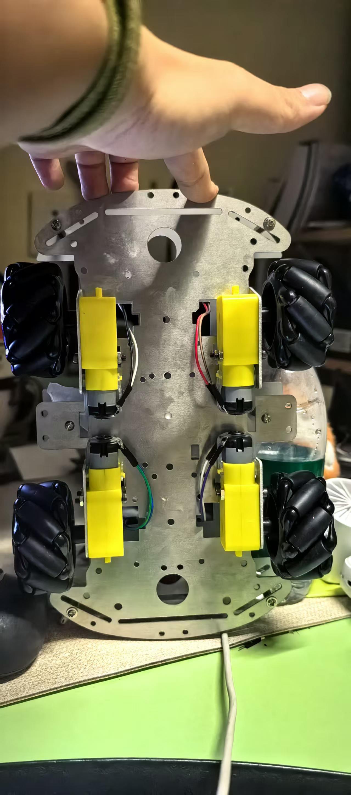
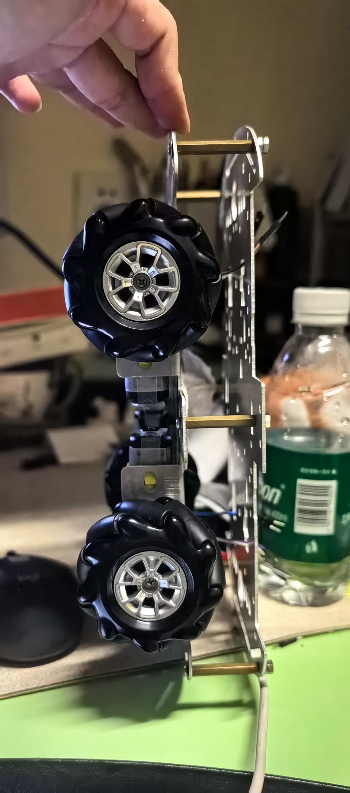
组长测量好了小车的各项数据，我一边建模小车，一边学习着solidworks，建模好小车后，用圆柱体来表示他的限高、限宽、限长；并做出了一个简易的机械臂，初步了解机械臂的结构设计。（但当时没做机械手，暂时没考虑这个）
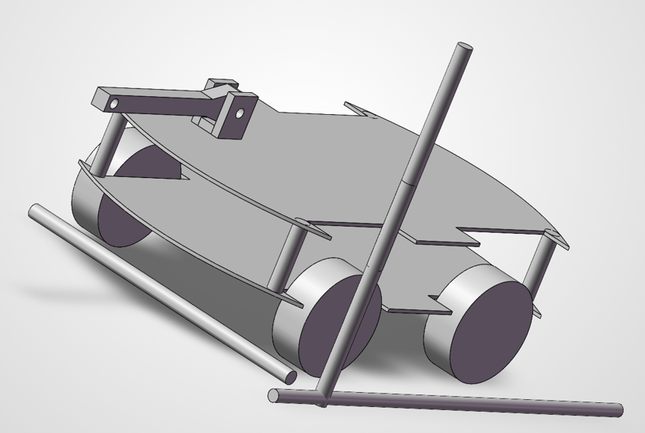
并学会了用评估工具，来测量零件具体长度，以及进行碰撞检测，来保证实物不会让底座和机械臂发生碰撞。此外这个时候没有给机械臂做适配舵机的空间、螺丝孔，只是用了装配体的配合约束等演示效果出来。
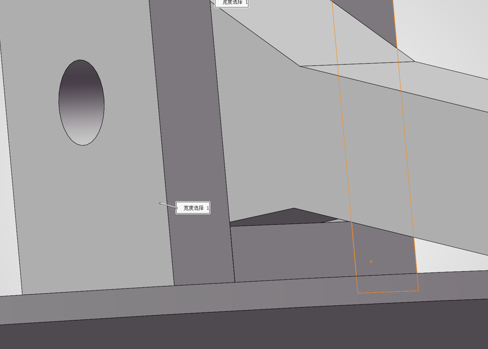
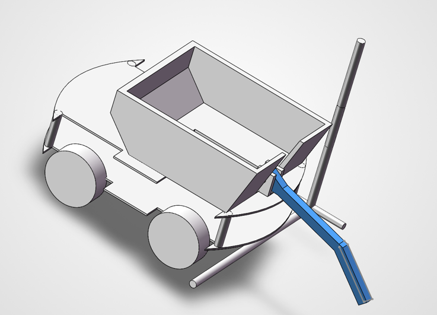
后续，我们开会研究了赛事规则，CRTC比赛场地，了解了方块分布，并将小车分工为高车和矮车，并由此推理出了机器人的具体目标。
高车的定位是将高台、洞内、细杆上的方块推到地上，便于矮车收集，而高车本身可以不容纳方块，高车只负责改变方块位置，便于矮车收集，当然我们也不保证以后的计划中，高车绝对不会承担收集的作用。
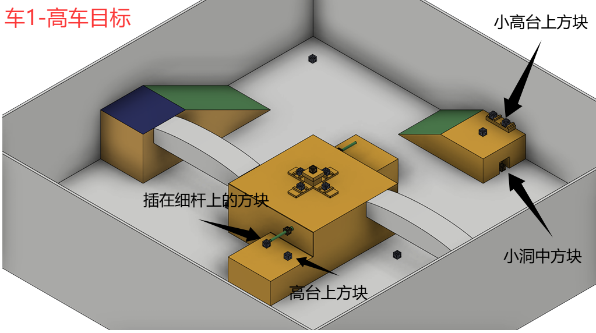
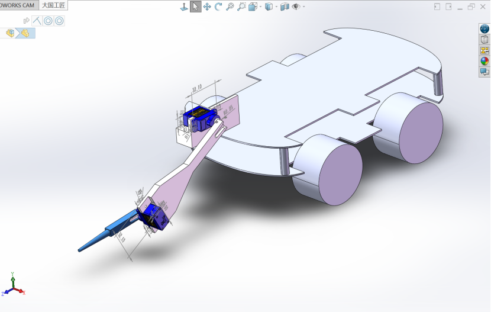
矮车的定位是像撮箕一样，将方块顶到墙上，方块会顺着一个小斜坡被挤上小车，小车两侧的机械臂会像蝎子一样，闭合，把方块“吃”进去，而吃进去后，就是矮车的容纳区域。矮车为了保证有区域，选择了倒装舵机。
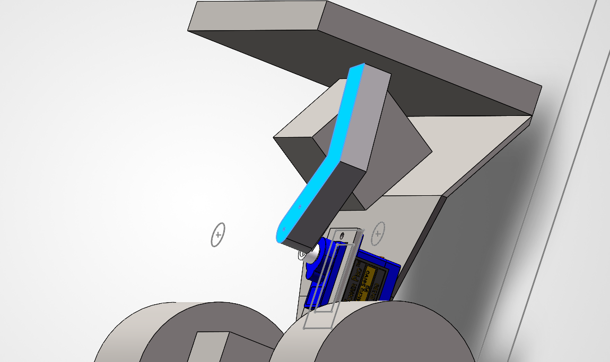
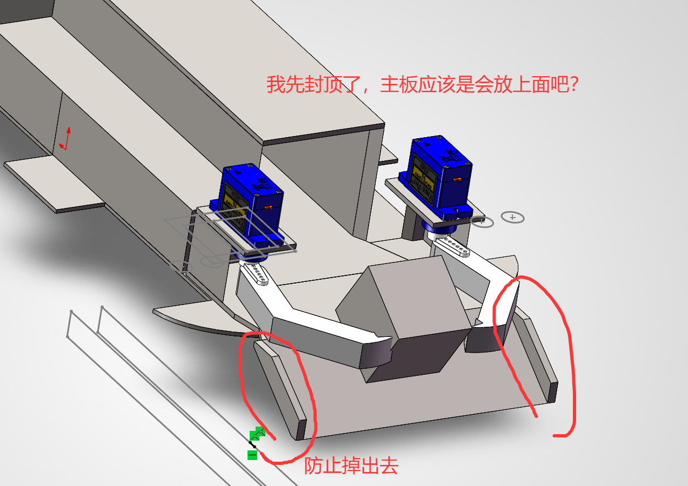
在做上面的任务之前，我们就已经做出了矮车、高车的精细版建模，保证处处还原现实，以严密设计零件，防止卡不进去之类的问题。
这个阶段我就学会了更多装配体的配合设定，像是同轴等，做出了更好的装配体。同时我也学会了测量舵机的相关数据，来给零件做出容纳舵机的孔洞和空隙，以及给螺丝的空隙。

## 高车锥形杆-转移方块功能

高车的前端没有使用传统机械爪，而是使用了一根圆锥。（不过不违反规则，尖端被切除了，并不锋利）选择圆锥大有考量。
我们一直在思考，为什么方块要生产成有棱角的呢？特别是比赛中，处于高台上方，被细杆串着，与墙紧密靠近的方块，怎么拿到呢，可能这就和方块的棱角有关。
有棱角，筷子那样有一个小尖端的东西就能插进去，产生一个横向推力，把方块往外推，于是高车的机械臂前端就使用了圆锥，希望能插入棱角，把方块推出。
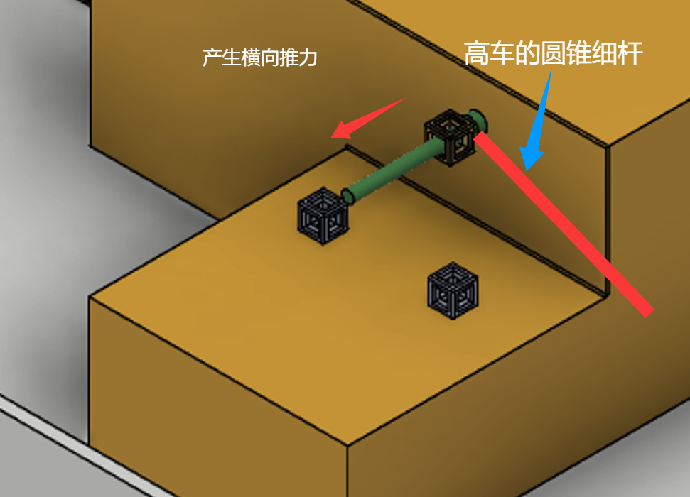
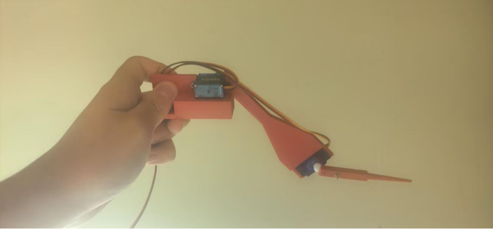
另一个考量，则是放在小洞内和小高台的方块，我们希望高车的细杆能插入方块中间的空间，把方块串进去，这样高车就能把方块转移出来，丢在地上，便于矮车拾取。

## 矮车低姿态方块收集与容纳功能

矮车负责吃方块并容纳方块。矮车的底盘很低，希望能用两个机械臂和一个小斜坡把方块吃进去，然后矮车上有空间用于容纳。

最后决定是舵机倒装，两个机械臂闭合，小车撞墙，把前方的方块挤上来，再用双臂吃进方块。

### 矮车结构件的打印与装配适配

实际打印出来，矮车还是遇到很多问题，ultimaker cura的设定有问题，导致打印速度过慢，以及支撑问题，为了解决支撑问题，我把原本的整体零件拆成多份，打印出来后再自己组装。为了解决速度问题，我学会了把多个零件的stl整合成一个Gcode文件。但实际打印出来还是遇到不少问题比如solidworks里面的1mm小孔，为了适配舵盘，结果实际情况是1mm的螺丝螺母就很少见，不过我最后还是买到了，更大的问题是实际打印的精度问题，这两个1mm的孔小到几乎没有，于是第二次打印我吸取了教训，把孔洞扩大了，比1mm大，实际打印才能有1mm。
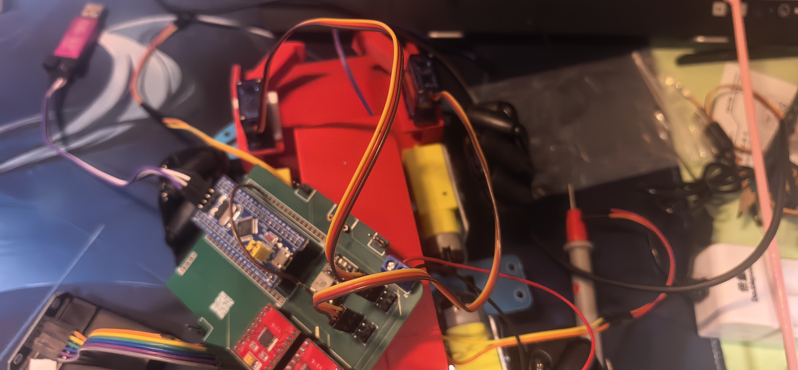

### 基于 Mearm 0.4 的双臂驱动适配

上文提到过，我们没有说高车绝对不会有收纳功能，于是这里就来了，高车的第二方案，使用Mearm机械臂。
后来我们有一段时间都在等快递，有空闲时间，于是我们找到了Mearm0.4这个开源机械臂，我找到了零件的stl并打印，用的是我们自己的打印机，为了避免排队。实际组装过程还有的问题是，我们没有购买官方零件，而是自己打印，所以很多地方对不上，很难组装进去，我使用了电磨笔去钻孔扩大原本的空隙，才把零件组装了起来。还有个难点是找不到对应教程，找到的教程使用的mearm版本很超前，有不少地方对不上，所以组装过程得靠自己的理解。最后组装成功，有些固定用了自己的理解而不是官方的方法。
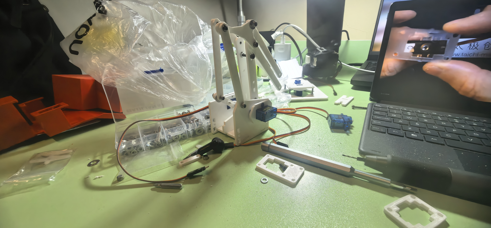
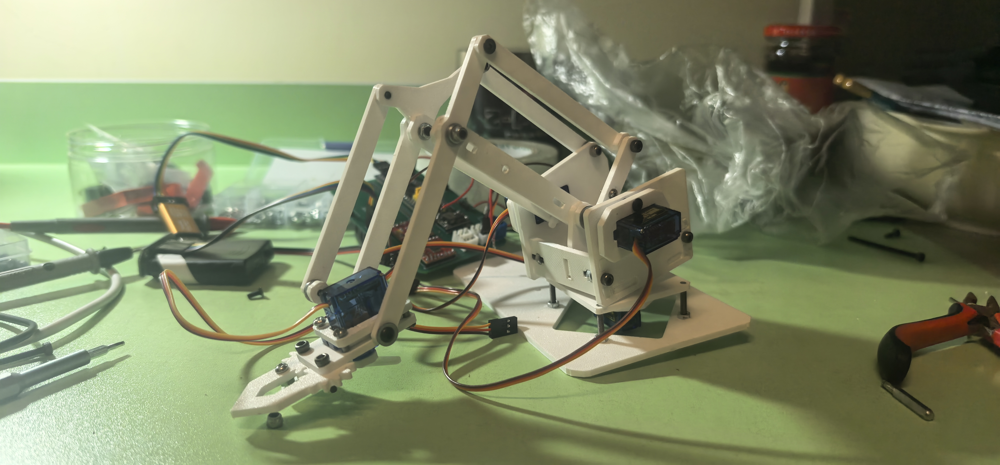
但很快实际使用遇到了问题，左右两个手臂经常卡住，经常遥控动不了，但断电后手动扭是可以动的，具体情况是，按手柄机械不动，但手扳一下就能动，而且动作剧烈，就像是之前的遥控信号被突然集中在了一起释放，并且舵机也有发热现象，最后我们觉得是舵机扭矩不够的问题。

于是新的方案是，我熬夜修改了原版零件，把mearm的左右臂拆掉重装，做出了一个适配MG996R的版本，把左右两手臂从sg90替换为大舵机，过程中还遇到过打印机喷嘴卡住无法打印的问题，但最后成功制作出了MG996R版本的Mearm，加入了原创成分。
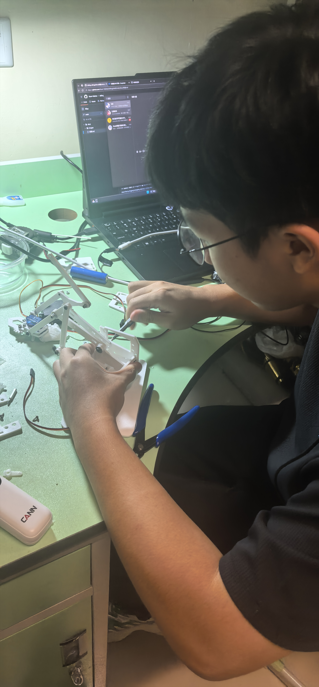
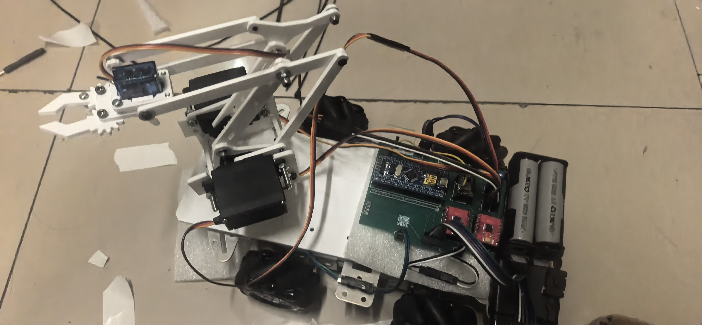

### 开源项目使用声明

项目名称：MeArm 0.4（Pocket Sized Robot Arm）
原始来源：MeArm 官方 GitHub 仓库（https://github.com/MeArm/MeArm），0.4 版本 3D 打印 STL 衍生件发布于 Thingiverse（thing:360108 / thing:616239）
原始作者：phenoptix / MeArm 项目
硬件许可协议：Creative Commons Attribution-ShareAlike 3.0（CC BY-SA 3.0），协议全文见 https://creativecommons.org/licenses/by-sa/3.0/

本队使用 MeArm 0.4 的 3D 打印 STL 零件模型，并进行了以下修改：
1. 将左右两臂舵机从 SG90 替换为 MG996R，修改舵机安装位置、连接结构和固定方式；
2. 因原 STL 按激光切割板材设计，3D 打印时对配合面和孔位进行适配修整；
3. 未采购官方套件，部分连接处装配顺序和固定方法依据实际结构自行判断。

上述修改后的硬件设计，本队同意在 CC BY-SA 3.0 协议下以相同方式共享。原始设计著作权归原作者所有。
